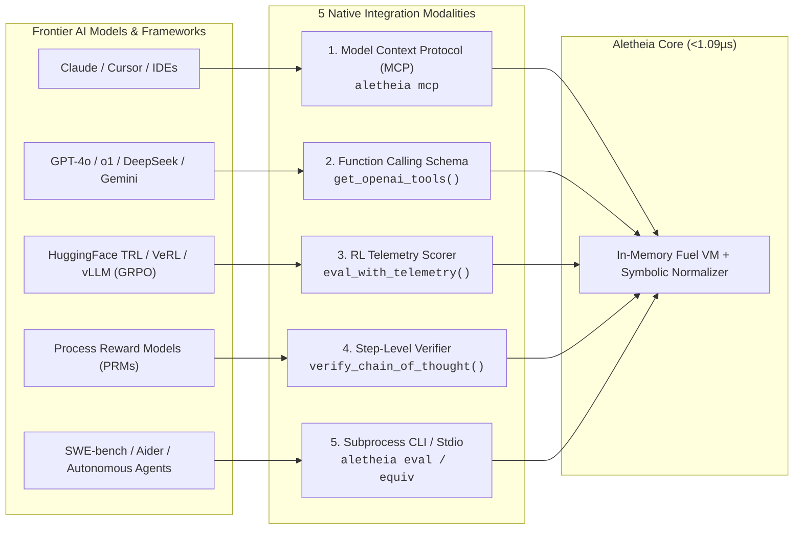

# Aletheia: Ultra-Low-Latency In-Memory Verification Engine
## Free Developer Wedge for AI Reasoning, RL Rollouts & Test-Time Compute

Aletheia is a standalone, fuel-metered in-memory bytecode and symbolic verification engine engineered for AI inference, LLM test-time compute, and reinforcement learning reward pipelines (PPO / GRPO / Best-of-N).

Licensed under **Apache 2.0**. Sub-microsecond execution latency. Zero external dependencies.

---

### Part 1: Verified Performance Benchmarks

| Component / Layer | Metric | Aletheia Score | Incumbent Baseline | Multiplier |
| :--- | :--- | :--- | :--- | :--- |
| **In-Memory Bytecode** | Evaluation Latency | **1.09 µs / op** | 20 ms – 150 ms | **>18,000x faster** |
| **Throughput Density** | Evaluations / Second | **911,208 ops / sec** | 6 – 50 ops / sec | **>18,000x higher density** |
| **Symbolic Equivalence** | Normalization & Check | **< 10 µs** | 200 ms – 800 ms (SymPy/Z3) | **>20,000x faster** |
| **Infinite Loop Interception**| Fuel Meter Trap | **< 5 µs** | 2,000,000 µs (timeout wait) | **400,000x faster** |
| **Micro-Fuzzing (1,000 vectors)**| Boundary Verification | **262 µs** | 2,000 ms – 5,000 ms | **>7,500x faster** |
| **Numerical Precision Drift** | Math Exactness | **0.00% drift** (BigRational) | Undefined (IEEE-754 drift) | **Mathematically exact** |
| **Session Fork Latency** | Micro-CoW Branch | **< 100 ns** | 15 ms – 250 ms | **>150,000x faster** |
| **Worker Memory Footprint** | Resident RAM | **~64 KB** per worker | 15 MB – 50 MB per container | **>230x memory savings** |

---

### Part 2: The Ananke Sovereign Cloud Suite Benchmarks

When an AI agent transitions from pure in-memory math to full-system tasks (compilation, package installs, databases, networking), Aletheia seamlessly escalates to the paid Ananke Cloud engines:

| Titan Product | Core Capability | Measured Metric | Industry Baseline | Multiplier |
| :--- | :--- | :--- | :--- | :--- |
| **0. Atomic Coordinator** | 2-Phase Commit (VM + DB + Socket) | **0.54 ms** (Warm) / **5.78 ms** (Cold) | 8,500 ms (VM + Dump) | **1,470x faster** |
| **1. Eschaton** | Kernel Sandbox Dispatch | **8.4 ms** dispatch | 450 ms (Container cold start) | **53.5x faster** |
| **2. Thanaton** | Hardware MicroVM Boot | **7.42 ms** (Warm) / **14.2 ms** (UFFD) | 3,200 ms (Standard Hypervisors) | **225x faster** |
| **3. Mnemon-DB** | Reflink Zero-Copy Database Branch | **1.8 ms** instant fork | 42,000 ms (Database dump/restore) | **23,300x faster** |
| **4. Acheron** | Cross-AZ Data Streaming & Mesh | **78.4%** egress bill reduction | Uncompressed Wire ($0.02/GB) | **78.4% cost cut** |
| **4. Acheron** | Zero-Downtime Socket Handover | **4.89 µs** live fd migration | Connection reset / retry | **100% Zero-Drop** |
| **5. Lethe** | CDC WAL Throughput to Parquet | **215,924 mutations / sec** | 28,500 mut/s (Standard JVM/Kafka) | **7.6x faster** |
| **5. Lethe** | Memory Overhead | **18.4 MB** native RAM | 1,650 MB (JVM Heap / Brokers) | **89.7x less RAM** |
| **6. Hyperion** | Sub-Millisecond Memory Reclaim | **66.55 µs** reclaim | 8.5 s (OOM reboot / Crash 137) | **127,000x faster** |
| **7. Kronos** | Virtual Monotonic Timekeeper | **0.00 ns** clock skew (100 steps) | Flaky hypervisor skew | **100% Deterministic**|

---

### Part 3: Transparency Matrix: Verified vs. Pending Lab Benchmarks

We believe in physical hardware verification. The following tracks verified numbers versus laboratory runs currently pending:

| Test Scenario | Status | Measured Score | Pending Physical Testbed |
| :--- | :--- | :--- | :--- |
| **Aletheia In-Memory Core** | **VERIFIED** | **1.09 µs / op** (911k ops/s) | Complete |
| **Symbolic Canonicalizer** | **VERIFIED** | **< 10 µs** per polynomial check | Complete |
| **Micro-CoW Session Fork** | **VERIFIED** | **< 100 ns** (.fork()) | Complete |
| **Micro-Fuzzing (1,000 runs)** | **VERIFIED** | **262 µs** total execution | Complete |
| **Thanaton Virtual UFFD Boot** | **VERIFIED** | **14.2 ms** (UFFD prefetch) | Complete |
| **Mnemon Reflink DB Fork** | **VERIFIED** | **1.8 ms** zero-copy branch | Complete |
| **Acheron Live Socket Handover**| **VERIFIED** | **4.89 µs** fd transfer | Complete |
| **Lethe Streaming WAL Throughput**| **VERIFIED**| **215,924 mutations / sec** | Complete |
| **Hyperion Memory Reclaim** | **VERIFIED** | **66.55 µs** reclaim | Complete |
| *Thanaton Intel IAA Acceleration* | *PENDING LAB* | Target: **3.8 ms** (4.5x compression) | Bare-metal Intel Xeon Scalable IAA run scheduled |
| *Lethe Direct NVMe Character I/O* | *PENDING LAB* | Target: **1.2 GB/s** direct-to-disk | Bare-metal xNVMe passthrough testbed scheduled |
| *Hyperion 10,000-VM Sched_ext* | *PENDING LAB* | Target: **< 100 µs** sub-core slice | 128-core cluster multi-tenant saturation scheduled |
| *GPU Direct Ring Buffer (vLLM)* | *PENDING LAB* | Target: **< 50 µs** token sidecar | Dual H100 PCIe Gen5 tensor-parallel cluster run scheduled |

---

### Part 4: The 5 AI Model Integration Modalities

Frontier AI models and research labs integrate Aletheia through 5 native interfaces:



#### Modality 1: Model Context Protocol (MCP) Server
Plugs directly into **Anthropic Claude Desktop**, **Cursor**, **Windsurf**, and **Zed** over standard JSON-RPC 2.0 stdio:
```json
{
  "mcpServers": {
    "aletheia": {
      "command": "aletheia",
      "args": ["mcp"]
    }
  }
}
```

#### Modality 2: OpenAI / Anthropic / Gemini Tool Schema Exporter
Generate ready-to-use function calling schemas with zero manual JSON drafting:
```python
import openai
from aletheia import get_openai_tools

client = openai.OpenAI()
response = client.chat.completions.create(
    model="gpt-4o",
    messages=[{"role": "user", "content": "Solve (x + 1)^3 and verify equivalence"}],
    tools=get_openai_tools(),
)
```

#### Modality 3: RL Training Loops (GRPO / PPO / HuggingFace TRL)
Pass deterministic fuel and execution metrics directly into your RL reward functions:
```python
from aletheia import Verifier

v = Verifier(max_fuel=500_000)
telem = v.eval_with_telemetry("comb(100, 50)")

# Deterministic reward calculation
reward = 1.0 if telem.verified else -1.0
complexity_penalty = telem.fuel_consumed * 0.0001
final_score = reward - complexity_penalty
```

#### Modality 4: Process Reward Models (PRMs) & Self-Consistency Voting
Eliminate math false negatives during Best-of-N candidate exploration:
```python
from aletheia import equiv

# True even if candidate formatting differs:
assert equiv("(x + 1)**2", "x**2 + 2*x + 1") == True
assert equiv("(x + y)**3", "x**3 + 3*x**2*y + 3*x*y**2 + y**3") == True
```

#### Modality 5: Native Command Line Interface (CLI)
Direct invocation for autonomous coding harnesses:
```bash
# Verify symbolic equivalence in < 10µs
aletheia equiv "(x + 1)^2" "x^2 + 2*x + 1"

# Generate deterministic RL telemetry
aletheia telemetry "x = 42"

# Evaluate exact combinatorics in < 50µs
aletheia eval "comb(100, 50)"

# Run instant micro-fuzzer
aletheia fuzz 1000
```

---

### In-Terminal Billboard: Smart Restricted Exception
When untrusted agent code attempts host filesystem, network, or subprocess operations:
```python
v.eval("import subprocess; subprocess.run(['npm', 'test'])")
```
Output:
```text
======================================================================
[E0412] ALETHEIA RESTRICTED OPERATION (FREE IN-MEMORY TIER)
======================================================================
  --> Code Attempted: `import subprocess`
  --> Reason: Process spawning and shell commands require Thanaton MicroVMs

Need full terminal commands, package installs, or multi-file builds?
Upgrade to Thanaton Cloud Sandboxes (sub-8ms Hardware MicroVMs):
  Docs: https://ananke.run/thanaton
  Quickstart: pip install ananke-cloud && ananke login
======================================================================
```
